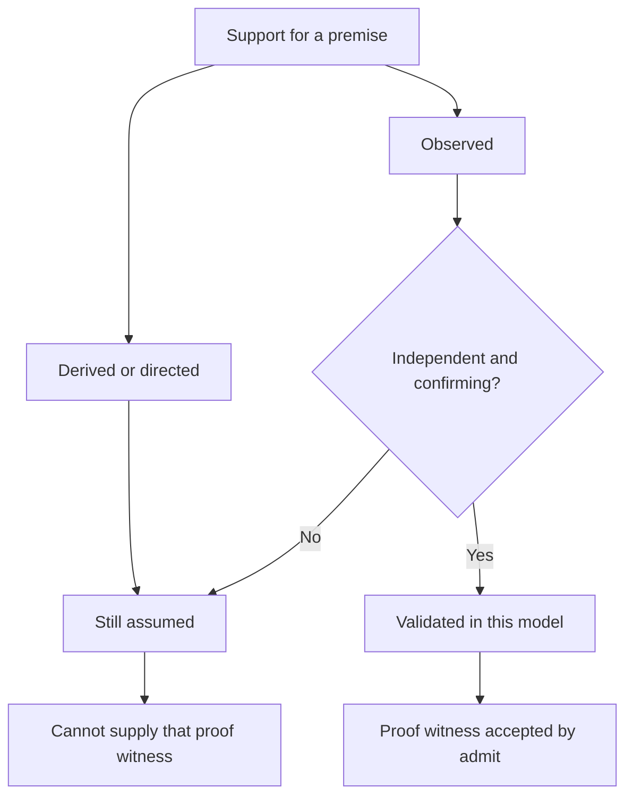

# Reasoning in Bend 2

An executable first translation of Genius's reasoning rules into Bend 2. Learning the language is the goal. This is separate from the messaging spike and does not change agent instructions or the evaluation kernel.

Start with `demo.bend`, then `evidence.bend`, then `reasoning.bend`.

## What runs

```text
Derived claim: False
Directed claim: False
Dependent observation: False
Unconfirmed observation: False
Independent confirmation: True
```

These values mean “eligible as validation under this model.” They are not truth values of real-world claims.



## Run it

Install Bend 2; version 2.0.40 was used here. The pure Bend modules need no Node, database, API key, or model provider. Python 3.9+ runs the automated acceptance checks.

From this directory:

```sh
bend demo.bend
bend PROOF.bend
python3 check.py
```

With an isolated compiler, use `python3 check.py --bend /absolute/path/to/bend` or set `BEND_BIN`.

For the stronger kernel check, install Lean v4.34.0 and put its `bin` directory on `PATH`:

```sh
bend PROOF.bend --verdict
python3 check.py --verdict
```

The checker runs the proof modules and demo, then asks the actual compiler to reject seven invalid programs. It matches the expected/observed type pair for each rejection and runs separate syntax-error and undefined-name controls to keep those unrelated failures from counting as semantic checks. The rejected attempts include admitting derivation, direction, dependent observation, or an unconfirmed observation as validation; skipping an observation implication; using double negation as though it were a witness; and omitting the no-cascade-risk norm.

## The written rules and their Bend forms

| Source | Bend form | Boundary |
| --- | --- | --- |
| [GNS-001](../../../docs/proofs/001-OBSERVATION-PRECEDENCE.md) | `observation_precedence`: compose the three implications to derive an observation witness from a non-trivial-action witness | The three implications are supplied premises; the function checks their composition |
| [GNS-004](../../../docs/proofs/004-INDEPENDENT-PREMISE-VALIDATION.md) | `validation_burden`: classification, dependency, the two implication premises, and the no-cascade norm rule out a refutation of validation | This proves double negation constructively |
| GNS-004's positive conclusion | `independent_validation`: discharge that burden with an explicit `Decision<Validated>` | Local decidability is additional logical input; it is not silently inferred from the prose |
| Full action path | `independent_validation_for_action`: observation, classification, and the validation derivation | The observation implication is supplied by GNS-001's proof; the norm remains explicit |
| [Postulate 001](../../../docs/postulates/001-THE-LOOP-IS-EPISTEMOLOGY.md) | `Support`, `validated`, and `admit`: an operational interpretation of the distinction between deriving and observing | An interpretation to examine, not a proof of the epistemological postulate |

### Propositions become types

In `reasoning.bend`, `Classified`, `Depends`, `Validated`, `Assumption`, and `CascadeRisk` are abstract proposition types. A value of one is its proof witness. `Classified -> (Validated -> Empty) -> Assumption` states a conditional premise: given classification and a refutation of validation, derive an assumption witness.

The `-` before a type parameter marks it erased: it participates in checking without becoming runtime data. Named function parameters expose the hypotheses the derivation needs. There are no foreigns, `@unsafe` definitions, open laws, or hidden logical axioms in these proof modules.

### Contradiction needs attention

The written GNS-004 proof reasons by reductio. Constructively, disproving “validation is impossible” yields `(Validated -> Empty) -> Empty`, not a `Validated` witness by itself.

`validation_burden` checks that portion without any classical axiom. `Decision<Validated>` then supplies one of two cases: a witness, or a refutation. In the witness case, return it. In the refutation case, the burden supplies a contradiction and `Empty.absurd` closes the case. The extra decision is explicit so the translation does not hide a stronger logical assumption.

This does not invalidate the written classical derivation. It identifies an input needed for this constructive rendition. A different experiment could instead make classical double-negation elimination an explicit hypothesis.

### A dependent type can require validation

The second parameter of `Evidence.admit` has type:

```text
{validated(support) == True{} : Bool}
```

Its type depends on the actual `support` argument. `admit(Derived{}, {==})` fails because that equality reduces to `False == True`. The checker accepts a reflexivity witness for `Observed{True{}, True{}}` because its equality computes to `True == True`.

Six laws check this finite support model, including rejection of dependent observations regardless of their confirmation flag. These are small model laws, not general theorems about evidence reliability.

## What is still assumed

- `Observed{True{}, True{}}` is fixture data. A caller can construct it; Bend cannot determine that a real observation happened or that its provenance is independent.
- The abstract propositions must be instantiated for a particular action and premise. This experiment does not bind evidence to real claim IDs, perform observations, assess reasoning independence, or execute agent actions.
- The finite support classifier is an example policy alongside the abstract derivation. No equivalence theorem between that policy and the entire written framework is claimed.
- Normative premises prescribe acceptable actions; they are not empirical guarantees that agents follow the rules.
- GNS-002, GNS-003, GNS-005, and GNS-006 are not translated here.

## Verification

`check.py` checks the positive proofs, exact demo output, and seven expected compiler rejections. The strong `--verdict` path additionally checks translated terms with Bend's Lean-backed kernel; the parser, translation, and runtime backend still have the trust boundaries documented by Bend.

No existing postulate or prose proof is changed. The experiment is meant to make its assumptions and derivation steps inspectable, then provide a concrete place to learn more Bend.
