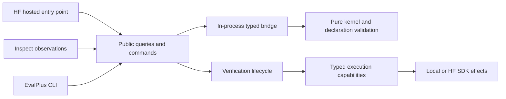

# Genius evals

[Inspect AI](https://inspect.aisi.org.uk/) runs repeated baseline/Genius comparisons and reports normalized results.
[Inspect SWE](https://meridianlabs-ai.github.io/inspect_swe/) supplies Claude Code and Codex integrations.
Hugging Face provides hosted Jobs, model access, and per-sample sandboxes; CI can launch the hosted path on manual dispatch.
Model calls and hosted compute can cost money. The test suite uses local sandboxes and mock models.

OCaml defines evaluation types, validates declarations, resolves run settings, and grades observations.
Python integrations consume canonical projections through typed public queries and commands.
The kernel is a compiler and pure grader. Public commands own verification and assessment;
Inspect adapts observations, task execution, and reporting to its SDK.



| Boundary | Owns |
| --- | --- |
| `ocaml/ast.ml` | Shared immutable domain types; fixture aliases the private abstract store |
| Primitive `.mli` / `.ml` files | Public operation signatures / executable constructors, validation and pure grading |
| `ocaml/projection.mli` | Separate public case, trusted verifier, and offline reference projections |
| `ocaml/experiment.mli` | Immutable defaults and validated launch overrides |
| `python/datasets/` | Dataset loading, native case snapshots, resource resolution, provenance, and case construction |
| `kernel/` | Standard findlib loading and Python stubs rendered from compiled interfaces |
| `python/integrations/datasets/` | Pinned download effects |
| `python/integrations/smoke/` | Reusable private Python assertion driver and reference-validation CLI |
| `python/integrations/inspect/` | SDK task/sample/score adaptation, agents, and sandbox capability adaptation |
| `python/queries.py` | Typed public queries returning canonical values directly |
| `python/commands.py` | Execution commands, validated launch settings and runtime composition |
| `python/verification.py` | SDK-free execution capabilities, immutable results and verification lifecycle |
| `python/integrations/hugging_face/` | Hosted Job entry point and HF SDK operations for VM lifecycle, command execution and file IO |
| `python/integrations/evalplus/` | Benchmark reference-validation CLI, EvalPlus manifest adaptation and trusted EvalPlus driver |
| `bin/` | Local launch and hosted bootstrap scripts |

Public `Case` values contain only ID, skill, prompt, and public files, including visible helper tools.
Reference solutions, expected answers, private verifier programs and private inputs use separate projections.
Only the trusted host or fresh grading sandbox receives those projections; agent samples and metadata receive public inputs and identifiers.
Commands and queries accept and return the OCaml-backed types directly; validation and grading policy remain in OCaml.

The public command and query operations remain. Their signatures use native
`Task`, `Case`, `Experiment` and `Verification` values directly; projection, settings and grading calls stay in the same process. There is
no JSON envelope, kernel executable or per-call subprocess. Dataset descriptions
and provenance remain Python-owned queries. Grading returns named boolean scores.

Dataset selection is a Python module name under `python/datasets/` or an immutable
`Dataset` returned by `load_dataset` or `compile_dataset`. Each bundled module supplies
`info` (optional provenance) and `cases()` (native `Task` values).
Python owns downloading and parsing upstream records. OCaml accepts the same
canonical declarations for every dataset, validates them through its constructors,
and exposes separate public, verifier, and reference projections.

To add a dataset, map its Python records into `Task` values and call
`compile_dataset(cases=..., info=...)`; no OCaml adapter or selector registration is
needed. A module under `python/datasets/` makes a dataset available by name to the
CLI. Evaluator integrations provide reusable executable checks, independently of
which dataset supplies their inputs. Verifier programs can be inline contents or
explicit `compile_dataset(resources=...)` resources. Dataset loading has no global
verifier list. Named modules supply inline checker contents; callers using explicit
resources compile a dataset with `compile_dataset(resources=...)`. Load a named
dataset once and reuse the resulting immutable `Dataset` for repeated queries and
verification, as the runners and reference-validation CLIs do. A genuinely new
grading capability may require a kernel primitive.

CI and local launchers supply overrides; OCaml resolves them into one immutable experiment specification before execution.
The HF launcher deliberately requests one epoch by default for its smoke run; direct job invocation uses the kernel default when no override is supplied.
The generic Inspect task builder accepts a sandbox selection and defaults to local execution.
The HF Job validates immutable `EvaluationSettings` at the environment-variable boundary
and calls `evaluate` with those settings as keyword arguments. The command passes validated
settings to Inspect; no JSON conversion occurs between Python modules.
SDK clients, credentials and operational state stay in integrations.

Shared domain types are defined once in `ast.ml`; public `.mli` files declare functions using those types, and `.ml` files implement them.
Dataset-record types remain private to their Python implementations.
Raw Ast records are validated at case projection and grading boundaries, including nested criteria, verifier contracts and reference fields.

Public operations carry dataset selection as context. `list_cases` returns public inputs;
`verify` and `assess` resolve private checks internally. Selection stays out of
the kernel grading observation; scoring supplies the case ID it already has.

Primitive modules have no SDK dependencies. Setup builds and installs the kernel with Dune;
ordinary imports load the findlib package with `ocaml.require`, and command/query calls invoke its bound operations directly. The default smoke driver executes Python candidates and private assertions in its isolated grading workspace.
Kernel domain projections are nonrecursive. Recursive diagnostics are frozen in public
results and converted to JSON values only at process or SDK output interfaces.
Boundary tests enforce these imports and the separation of dataset loading from SDK integration code.
Kernel source contents, canonical declarations, private records, provenance and verifier resources participate in provenance or cache keys.
Invalid candidate submissions produce unsuccessful outcomes; provisioning, transfer, driver and bridge failures remain harness errors.

## Check the harness offline

Install opam, Python 3.12, [uv](https://docs.astral.sh/uv/getting-started/installation/),
Git, Make and a C compiler. The setup script creates the isolated
`genius-kernel-414` switch with OCaml 4.14.2 and installs a pinned
`ocaml-in-python` bridge and Dune 3.24.2. Setup builds and installs the `genius_evals_kernel` findlib library. A small pinned bridge patch keeps its compiler scratch files
out of the working directory.

```sh
opam init --bare --no-setup
uv sync --project evals --python 3.12 --extra dev --locked --inexact
make -C evals setup-kernel
opam install --switch genius-kernel-414 --yes ocamlformat.0.29.0
opam exec --switch=genius-kernel-414 -- make -C evals check
```

Python entrypoints below run under that same opam switch. Setup compiles the library
and its binding reader with OCaml 4.14 compiler-libs. The reader uses
`Cmi_format.read_cmi` to inspect the compiled public interface; Python renders that
structural description into `.pyi` files. Includes, inferred signatures, labels,
and type identities come from the compiler. Unsupported constructs fail explicitly.
`check-python` verifies the generated stubs before mypy; the stubs and Dune's
`_build/` directory are ignored by Git. After changing OCaml sources, rebuild with
`make -C evals setup-kernel` and restart Python. To refresh only the stubs of an
already built library:

```sh
opam exec --switch=genius-kernel-414 -- uv run --project evals python evals/kernel/generate.py
```

This installs locked dependencies, checks strict typing, runs tests, and enforces CRAP ≤5.
`check` runs five parts that also run alone: `check-scaffolding`, `check-ocaml-format`
(ocamlformat style), `lint-ocaml` (compilation with every warning as an error),
`test-ocaml` (kernel tests in `ocaml/tests/`), and `check-python` (Ruff format and lint,
strict mypy, tests, coverage, Xenon).
`make -C evals format` applies both styles: ocamlformat from `.ocamlformat`
and Ruff from `pyproject.toml`.

Functions take at most one positional argument, usually an ID or the value they
act on. Callers name every other argument. Ruff enforces this for Python
(`PLR0917` with `max-positional-args = 1`), including tests, because pytest
passes fixtures by name. Inspect calls solvers, scorers, and mock-model callbacks
positionally, so those carry a `noqa` with the reason; methods marked
`@override` keep their base signatures. OCaml follows the same rule with labeled
arguments, by review.
Tests exercise Inspect's real engine with its mock model and scripted test agents.
They use temporary local sandboxes and need no API keys.
Scripted passes verify the harness; they do not measure Genius performance.

Reports and native offline logs are saved under `evals/results/`.

## Continuous integration

GitHub Actions minutes are free for this public repository.

- `.github/workflows/evals.yml` runs on pushes and pull requests that touch
  `evals/`, `docs/`, or `skills/`. Its `check` job runs `check-scaffolding`,
  `lint-ocaml`, `test-ocaml`, and `check-python` in the Hugging Face Job image
  (`ghcr.io/astral-sh/uv:python3.12-bookworm` with the same pinned OCaml 4.14 bridge setup). Its
  `format` job runs `check-ocaml-format` with ocamlformat 0.29.0.
- `.github/workflows/hf-evals.yml` launches a paid hosted run on manual dispatch
  (Actions → HF evals → Run workflow). It runs the `evals.yml` checks first, then
  `bin/hf_host.sh`, streams the Job logs, and fails if the Job fails. Add an `HF_TOKEN`
  repository secret with write access. HF Inference Providers models use this same
  token, with inference permission; no separate provider key is required. Add
  `OPENAI_API_KEY` or `ANTHROPIC_API_KEY` only for direct calls to those providers.
  The `HF_NAMESPACE` repository variable defaults to the repository owner.

GitHub dispatches only workflows that exist on the default branch. Before this
workflow reaches `main`, launch from a local checkout with `sh evals/bin/hf_host.sh`;
it needs only uv, Git, and a Hugging Face login.

## Run live comparisons on Hugging Face

Create a [Hugging Face account](https://huggingface.co/join) with a positive Jobs
credit balance. Authenticate from the shared workspace with
`uvx --from huggingface_hub==2.2.0 hf auth login`; the browser login keeps the
token out of chat. A Hugging Face Inference Providers model needs only that
Hugging Face token. OpenAI and Anthropic models need their own provider API keys;
a ChatGPT or Claude subscription does not supply an API key for Inspect.

HF Job logs name the provider `genius-hf`: this adapter uses Inspect's HF provider
and removes Codex's `prompt_cache_key`, which HF's chat endpoint rejects. It uses
non-strict tool schemas so Codex's optional arguments remain valid. It keeps the
requested model ID and HF authentication.

Run from a checkout of the completed eval stack, or `main` after both PRs
merge. The private source repository and results bucket already exist for
`shaquan1228`; the launch script safely reuses them. From the repository root:

```sh
uvx --from huggingface_hub==2.2.0 hf auth whoami
export HF_NAMESPACE='shaquan1228'
export EVAL_MODEL='hf-inference-providers/openai/gpt-oss-20b:nscale'
sh evals/bin/hf_host.sh
```

That first example runs the Codex harness against a Hugging Face hosted model.
The `:nscale` suffix pins its inference provider. The automatic Groq route
returned malformed tool names during smoke testing; use an explicit provider
when comparing runs.
To evaluate the target Codex or Claude models, use `openai/<pinned-model-id>`
with `OPENAI_API_KEY` or `anthropic/<pinned-model-id>` with `ANTHROPIC_API_KEY`.
Set the matching key in your shell or secret manager before launching the Job.
The script selects Codex for Hugging Face and OpenAI models, and Claude Code for
Anthropic models. Set `EVAL_AGENT` and `EVAL_VERSION` to override the agent or
its pinned version.
The first run defaults to one epoch (eight agent sessions) to test the hosted
path. After checking its results, run `EVAL_EPOCHS=5 sh evals/bin/hf_host.sh` for
the full 40-session comparison.

`bin/hf_host.sh` uploads only tracked files from the current Git commit, so commit
changes before running it. It creates a private dataset repository containing
the evaluation source, a private results bucket, and a Hugging Face Job. The
launcher streams logs and waits for the final Job status; it exits nonzero if the
Job fails. The Job runs Inspect and launches a dedicated Hugging Face Sandbox VM
for each sample.
Only task files and the selected skill enter that VM; held-out checks stay in
the Job and run against the VM after the agent finishes. The script prints the
Job ID. Watch it at `https://huggingface.co/jobs/shaquan1228/<job-id>` or with:

```sh
uvx --from huggingface_hub==2.2.0 hf jobs logs -f <job-id>
uvx --from huggingface_hub==2.2.0 hf jobs inspect <job-id>
```

The logs command streams output; use `jobs inspect` to confirm the final status.
Native Inspect logs are saved to the private
[`genius-eval-results` bucket](https://huggingface.co/buckets/shaquan1228/genius-eval-results)
under `live/`.

Both profiles share the selected model, agent version, effort, tools, and limits.
Every sample and epoch starts with fresh task files and a fresh agent session.
Codex configuration and session state live under `/root/genius-codex`, outside
the measured repository, so harness bookkeeping does not count as agent edits.
Codex refuses to install its `apply_patch` helper when its home is under `/tmp`.
Login shells are disabled so shell startup files do not discard the helper's `PATH` entry.
The agent's `attempts=1` prevents retries after a failed submission within one
session; epochs provide independent attempts for estimating pass rates.
Agent retries and model-response caching are disabled. Provider transport retries retain Inspect defaults.
Each session has a model dollar limit and a 300-second time limit. There is no
cumulative token or message cutoff by default. Required instruction reads and
tool replies count toward Inspect message limits, so a small message cap gives
the two profiles unequal room for task work. Explicit positive message overrides
remain available through `queries.resolve_settings(message_limit=...)`.
Task metadata records agent versions and hashes of instructions, fixtures, and the manifest.
Inspect logs record model usage, sample events, answers, errors, and scores.

Compare each task across profiles; require both correctness and scope to pass.
Inspect reports each score separately. Scores are not inferred from agent claims.

A crash of the agent process does not stop the task.
The scorer grades the files that the agent left in the workspace.
An unchanged workspace fails its checks.
The score records the crash message in its `agent_failure` metadata and its explanation.
The task then continues with the next sample.
The Job log shows the number of crashed samples for each task.
Sandbox and verifier failures still stop the task.

## Author cases

Python datasets construct native `Task` values. The example in
`python/datasets/smoke.py` uses `Instruction`, `Code` or `Answer`, and
`Reference`; `fixture_ops.of_files` constructs the opaque file map. Import native types and constructors directly from `kernel`, such as
`Task`, `Instruction`, `Answer`, and `Rubric`. The implementation keeps fixture
operations in the private `kernel._operations` binding layer. Public queries return `Case`, which
excludes private checks and reference solutions.
Python-only metadata and SDK execution capabilities remain Python-owned.

```python
from evals.python import commands
from evals.python import queries
from evals.python.datasets import smoke as declarations

definitions = declarations.cases()
dataset = queries.compile_dataset(cases=definitions)
public_cases = queries.list_cases(selection=dataset)

# In an async caller, validate the first case's known reference offline.
verification = await commands.validate_reference(
    case_id=public_cases[0].id, selection=dataset
)
scores = queries.score_case(
    case_id=public_cases[0].id,
    selection=dataset,
    response="Each quantity now contributes to the total.",
    changed_files=("workspace/receipt.py",),
    verification=verification.verification,
)
```

Run all four smoke references from the repository root, with the kernel compiler environment
configured as above:

```sh
opam exec --switch=genius-kernel-414 -- uv run --project evals python -m evals.python.integrations.smoke
```

The CLI compiles the declarations, validates each reference, grades correctness and
scope, prints only IDs, verification statuses and scores, and exits nonzero on an
unsuccessful score or harness failure. It makes no model calls or hosted requests.
The coding cases fix receipt quantities in `receipt.py` and timeout defaults in
`config.py` and `client.py`. The answer cases retain numeric choice and hindsight
after one loss. Private assertions and reference solutions never enter `list_cases` or
the CLI output.

`load_dataset(selection="smoke")`, Inspect tasks, and the HF launcher's default
selection all compile these same Python declarations through the native OCaml
constructors. Native OCaml dataset adapters and suite-path selection have
been removed. Kernel unit tests use inert local fixtures rather than the runnable
smoke dataset.

The fixture, instruction, criterion, edit scope, and reference remain independent
values. Use `declarations.receipt(term=...)` and
`declarations.timeout(initial=..., requested=...)` for parameterized smoke examples,
and replace IDs when composing multiple variants into one dataset. The kernel
rejects checks that read missing fixture files and reference edits outside the
allowed scope. Add a genuinely new success condition to `ast.ml`, its validating
constructor to `criterion.ml`, and its pure grading logic to `grader.ml`.

Structured answers use `Answer(Rubric(...))` with named `String`/`Bool`
expected fields and an optional `TextRule`. A field named `reason` has no special meaning unless
the criterion declares it. Adding answer fields does not require a new binding or API operation.

## Execution boundary

`from kernel import Case, Task, Rubric` loads the installed
`genius_evals_kernel` findlib package with `ocaml.require`. Dune wraps the pure
modules to avoid collisions with modules already loaded by the bridge. The fixture
map lives behind `fixture_store.mli`'s abstract type.

The pinned bridge cannot bind the ordinary nested module aliases for these domain
records (it raises an unbound converter error). A Dune build rule therefore generates
a flat public interface from the compiled domain and operation `.cmi` files using
compiler-libs `Subst` and `Printtyp`. It exposes the fixture as abstract and preserves
the compiler's constructors and operation signatures. No domain declaration is copied
into a handwritten binding interface. The Python binding generator consumes this final
public `.cmi`, including its nested operation signatures. It emits capitalized
native type and constructor imports at `kernel`; operation modules stay in the
private `kernel._operations` namespace. `Rubric` names the native `answer` record,
while `Answer` selects the answer-grading criterion. The exported objects retain
their original native identities.

Python imports never build the kernel library. The bridge still compiles its own
conversion functions internally; `kernel/bridge.patch` addresses its independent
scratch-file bug. Dune does not replace or remove that upstream patch.

The library embeds its exact trusted build sources. Dataset provenance uses this
installed snapshot, so editing source after setup cannot attribute new source to old
loaded policy. Rebuild and restart to use changed policy; native type identities stay
fixed for each process. There is no content-addressed runtime plugin cache.
Dataset snapshots retain typed declarations and explicit resources. Resource
changes invalidate consumer projections without rebuilding native code.

Queries and commands call the native OCaml operations directly. Dataset loading,
private snapshots and resource resolution live in `python/datasets/__init__.py`.
SDK adapters convert native values only at their IO boundary; there is no Python
domain-model mirror, catalog façade or transport layer. The loader preserves the
host's environment when initializing the OCaml/Python runtime. CI and the hosted
bootstrap install the same pinned toolchain before running the harness.

Agent samples receive only public project files, selected skill instructions, and
a case ID. Private checks and reference edits remain host-side and do not enter
sample metadata or the agent workspace. Reference validation stages reference
edits in a separate temporary candidate environment; scripted test agents also
use them for offline checks.

Inspect prepares one `queries.load_dataset` snapshot, provenance, and instruction byte
snapshot before constructing an evaluation's tasks. Profile selection, prompts,
sample files, and instruction hashes consume those supplied values. Instruction
mounts use data URIs from the snapshot, so later source edits cannot change the
mounted content. Baseline mounts no instructions and records the same Genius
instruction hash as the comparison tasks. Standalone `baseline` and `genius`
task entry points each prepare their own inputs.

The scorer binds the prepared dataset on the host. Only its public Inspect
registration is copied to the callback; private datasets never become decorated
factory arguments, which Inspect serializes into native logs. The registered
scorer remains available for named-dataset rescoring using the public dataset
selection in sample metadata. Reconstructing an externally authored in-memory
dataset requires supplying that dataset again.

Smoke workspaces include public Python checks. Run them without creating bytecode
artifacts in the measured worktree:

```sh
python3 -I -B test_receipt.py
python3 -I -B test_client.py
```

After the agent finishes, the harness creates a fresh grading sandbox using the
same provider. It copies only the declared submission inputs and trusted verifier
artifacts, then streams private input to the declared command. The driver returns
a structured outcome with a fresh completion marker. Provisioning and transfer
timeouts are harness errors; the verifier command's deadline is a distinct timeout
outcome. The grading sandbox is cleaned up after success, failure, or cancellation.

The smoke verifier runs private Python assertions in a child process. It uses a
separate inner completion marker after all assertions, so an early successful exit
fails correctness. The child does not inherit the host completion marker, and the
verifier kills and reaps its child process group on termination. Agent edits to public helper scripts do not alter the trusted grader
copies. Completion markers do not isolate hostile code sharing the grader process.

Scope checks compare the final worktree against its original commit.
They detect agent commits, untracked files, ignored files, and changed instructions.

The four cases cover clear-task completion, known preflight fields, numeric choice, and hindsight after one loss.
The suite composes sources, prompts, and assertions from their respective modules.
Reply checks compare each expected field with its exact JSON type and bound the reason;
they do not judge explanation quality.
Question usefulness and reasoning quality require human review of saved traces.
These small regression tasks do not establish that Genius improves performance overall.

## Enforce CRAP ≤5

The standard [CRAP formula](https://pypi.org/project/pytest-crap/) is:

```text
CRAP = complexity² × (1 − coverage)³ + complexity
```

`make check` requires 100% statement and branch coverage using coverage.py.
Xenon's rank-A gate requires every function's cyclomatic complexity to be at most five.
At full coverage, CRAP equals complexity, so those gates enforce CRAP ≤5.
Radon exports measured complexity to `results/complexity.json`.

Python coverage and complexity include all adapter runtime code, harness tests,
and scripted helpers. Python smoke checks execute seeds, solved fixtures, partial
fixes, malformed code, and visible test commands.
`make test-ocaml` checks module boundaries, case relationships, and grading policy.
Neither is included in Python coverage or the Python CRAP calculation.
Strict mypy checks the Python modules without type-ignore exceptions; `ocamlc`
type-checks fixture modules and assertions on every execution.


## Effectful Complexity

Effectful Complexity (EC) is a project heuristic used alongside CRAP:

```text
EC(scope) = sum(CC(function) * effectful(function))
```

`CC` is the pinned Radon cyclomatic complexity. `effectful` is one when a
function directly or transitively executes I/O, reads ambient mutable state, or
mutates externally visible state; otherwise it is zero. Review the executed
call paths, including SDK registration hooks. Deferred callback bodies are
classified separately from their factories. Unknown callees remain effectful
until their behavior is checked.

Measure the same responsibility scope before and after a change, including new
or relocated helpers. Use the raw sum, not an average or a fraction that can be
improved by adding pure wrappers. Moving a read into another function retains
the caller's effect classification and adds the wrapper's complexity.

Pure matching, comprehensions, local bindings, and deterministic validation do
not count as effects. Comprehensions that read files still do. EC does not
measure readability, local accumulation, or runtime effect frequency. Reject
score-only extraction, introduce no mutable accumulators or recursion in
composition, and verify that shared inputs are acquired once per evaluation.
Explicit matching remains appropriate where alternatives select execution.
The existing recursive diagnostic-value conversion is outside this refactor.

The preparation refactor at `de9725f` compares its audited slice against `bff5602`:

| Responsibility | Before EC | After EC |
| --- | ---: | ---: |
| `inspect/profiles.py` composition and instruction acquisition | 22 | 5 |
| `inspect/tasks.py` task construction and entry points | 7 | 7 |
| `inspect/evaluation.py` task expansion and execution | 15 | 13 |
| `inspect/scoring.py` runtime scoring and SDK registration | 3 | 5 |
| `catalog.py` dataset resolution | 2 | 2 |
| `queries.py` public dataset loader | 0 | 1 |
| `commands.py` optional-check verification dispatch | 2 | 4 |
| Total | 51 | 37 |

The verification dispatch retains exhaustive `match`, despite its higher raw
complexity. Keep a reviewed function classification with local measurement
receipts in `results/effectful-complexity.json`; this is a scoped comparison,
not a whole-repository purity score or an automated purity proof.

## HumanEval+ coding benchmark

`humanevalplus` maps all 164 HumanEval+ v0.1.10 problems in Python into canonical
case declarations, which OCaml validates and projects. The upstream release is
public and requires no API key. The free commands below show the pinned provenance, then download and
checksum-verify the dataset into the user cache and validate three references:

```sh
opam exec --switch=genius-kernel-414 -- uv run --project evals python -m evals.python.integrations.evalplus.benchmarks info
opam exec --switch=genius-kernel-414 -- uv run --project evals python -m evals.python.integrations.evalplus.benchmarks validate --limit 3
```

On macOS, trusted reference validation can explicitly work around EvalPlus's
incompatible memory guard with `--trusted-macos-memory-workaround`. This flag is
only for the bundled upstream reference code. The verifier disables EvalPlus's
incompatible memory guard; the HF grading VM supplies the memory bound.

Each agent sees only `solution.py`, containing the original prompt and function
signature. Baseline and Genius receive the same public problem. Canonical
solutions and base/plus inputs stay in the private host index and fresh grading
environment. The original JSON record crosses the kernel as an opaque string,
preserving integers larger than floating-point precision. Grading runs the
pinned official EvalPlus checker, separately for base and plus inputs; correctness
requires both groups to pass. Metadata records both upstream statuses, test
counts, dataset digest, evaluator commit, and runtime versions. A timeout remains
an upstream timeout result; infrastructure errors fail the sample.

`evals/python/datasets/humanevalplus.py` owns dataset provenance and constructs the cases.
`python/integrations/evalplus/` supplies executable checks using the official evaluator.
`ExecutableChecks` runs them through the same generic verifier as other coding
cases. No dataset-specific scorer or Python-to-OCaml transpilation of benchmark
programs is required. The evaluator is pinned to commit
`6eb1e199c2e370518e7bf3e8eee6322c2b23c89c`; its minimal evaluation dependencies
are pinned in the project lockfile. Fresh sandbox graders install those exact
packages into a temporary private directory when unavailable.

Canonical solutions are validation candidates, not scoring authority. The
unmodified v0.1.10 reference for `HumanEval/32` fails the official expanded tests
with this evaluator due to a numerical issue. Its failure is retained and
reported; the adapter does not weaken or rewrite the benchmark. Reference
validation exits nonzero when any case fails or encounters an infrastructure
error.

For a model run, select `humanevalplus` in the manual HF workflow and optionally
set `limit` for a small probe. The equivalent local launcher settings are
`EVAL_DATASET=humanevalplus EVAL_LIMIT=3`; omitting `EVAL_LIMIT` runs all 164
problems per profile and epoch. `EVAL_JOB_TIMEOUT` defaults to `4h` and can be
explicitly increased for larger runs. No model calls or paid Jobs are made by the
`benchmarks` CLI. Inspect logs include the dataset selection, pinned provenance,
case hash, and each sample's verifier evidence.

## Controlled instruction-delivery diagnostics

Integrations call typed public queries and commands directly:

```python
from evals.python import commands
from evals.python import queries

dataset = queries.load_dataset(selection="humanevalplus")
cases = queries.list_cases(selection=dataset)
settings = queries.resolve_settings(epochs=2, cost_limit=0.25)

# At the Inspect scoring interface, after capturing public observations:
assessment = await commands.assess(
    case_id=case_id,
    selection="humanevalplus",
    response=completion,
    changed_files=changed_files,
    agent=environment,
    runtime=runtime,
)

exit_code = await commands.evaluate(model="openai/your-model", dataset="humanevalplus")
```

Each callable validates its arguments and returns its declared result directly.
`load_dataset`, `list_cases`, `resolve_settings`, `compile_dataset`, `describe_dataset`, `get_provenance`,
`get_reference` and `score_case` are queries. They load or derive dataset values
and experiment settings.
`commands.create_runtime` synchronously assembles provider execution capabilities.
`verify`, `assess`, `validate_reference`, and `evaluate` are asynchronous
commands that own execution effects. `describe_dataset` reads metadata without
downloading/importing all cases;
`get_provenance` includes source and private-case fingerprints.

`evaluate` validates launch arguments into immutable `EvaluationSettings` before
loading the runner SDK. HF parses its environment once into the same settings type
and passes keyword arguments to `evaluate`; Inspect receives validated settings
and awaits its SDK's `eval_async`. Profile/sample/task builders consume canonical values directly.
Integrations do not import sibling implementations or private kernel projections.
The public contract has no integration-local command handlers or dataset clients.

Verification owns candidate reads, fresh grader allocation, trusted artifact
staging, execution, result decoding and cancellation-safe cleanup. Environment
capabilities expose only execute, read bytes and write bytes; runtime capabilities
allocate and clean up environments. SDK clients remain inside their adapters.
Missing candidate input is invalid submission, setup/transfer failures are harness
errors, and a verifier command deadline is timed out. Answer-only cases allocate
no grader. Assessment then asks OCaml to grade the canonical outcome.

JSON is used for dataset records, candidate structured replies, standalone verifier
output, CLI input/output, provenance hashes and persisted logs. Kernel calls pass
native typed values directly.
Standalone drivers require no project imports in their isolated `python -I`
environments; the public process interface decodes their wire results once.

Keep the historical file-loading treatment as the default. For a small HF
comparison of the same reasoning documents with explicit reference paths:

```sh
export EVAL_DATASET=humanevalplus
export EVAL_SAMPLE_IDS='["humaneval-20","humaneval-38"]'
export EVAL_EPOCHS=2
export EVAL_DELIVERIES='["files","manifest"]'
sh evals/bin/hf_host.sh
```

`EVAL_SAMPLE_IDS` must be a nonempty JSON list of unique known IDs and cannot
be combined with `EVAL_LIMIT`. Invalid cohorts fail before sandbox allocation.
`EVAL_DELIVERIES` creates separate Genius tasks for each treatment and repeat,
reverses treatment order on even repeats, and runs tasks and samples serially.
These are instruction-delivery comparisons, not baseline-versus-Genius trials.
The logs retain delivery and diagnostic-repeat metadata.

`files` preserves the original prompt. `manifest` adds the absolute paths of
reasoning's four required documents. `inline` embeds their complete unchanged
bytes in the initial prompt. All modes mount the same files and keep private
checks outside the agent VM. Explicit delivery modes currently support only
reasoning cases; they reject other skills rather than silently replacing them.
For a normal baseline/Genius run with a chosen delivery mode, leave
`EVAL_DELIVERIES` unset and set `EVAL_INSTRUCTION_DELIVERY` instead.
`EVAL_COST_LIMIT` sets the same model dollar limit per sample and epoch in every arm
(default `$0.25`). There is no cumulative token cutoff. The 300-second time limit
remains active. For example, `EVAL_COST_LIMIT=0.10` allows ten cents per attempt.
This covers model usage, not HF parent/child VM charges. A 20-problem, two-arm,
one-epoch run has 40 independently capped attempts.

HF routes require `EVAL_MODEL_COST` with the exact selected provider's USD prices
per million tokens: `input`, `output`, `input_cache_write`, and `input_cache_read`.
All four fields are required, finite and nonnegative. Use current billed cache
rates; a zero cache rate is valid only if that usage is actually free. No model
vendor price is inferred for an HF provider route. Other providers may use Inspect's
built-in prices, or the same explicit override. Missing pricing fails before
sample VMs are allocated. The public command accepts `cost_limit=0.25` and a
`commands.ModelPricing(...)` value as `model_cost`.

The parent logs the resolved cap and prices; native Inspect logs retain usage,
costs and cost-limit cutoffs. Cost is checked after each model response, so the
last response can exceed the limit and its requested tools may not run. Generated
patches are not proof of executed edits. Report cutoffs separately from crashes
and errors.

Keep optimization receipts and native run logs local and uncommitted.

### Observable parallel runs

Set `EVAL_MAX_SAMPLES=2` to run two samples concurrently within a profile (default `1`, maximum `16`). Profiles remain serial; instruction delivery diagnostics always use one sample at a time. The public `evaluate(max_samples=2, ...)` entry point uses the same validation.

The parent prints flushed JSON events for run settings, exact expected task/case/epoch tuples, sample initialization/start/end, a heartbeat every 30 seconds, and a final completeness report. Heartbeats include active sample identities, completed count and elapsed time, including sandbox provisioning. An interrupted sample gets an `aborted` terminal event. Native Inspect logs retain scoring evidence; telemetry contains identifiers and counts, without prompts, answers or private grading material. Missing or duplicate records, sample errors, failed tasks, or incomplete lifecycle telemetry fail the run even if its process otherwise exits cleanly. Crashes and cost/time/message cutoffs are counted separately in the final report.

Set `EVAL_SANDBOX_IMAGE` to a prepared image to skip repeated system package installation. See [sandbox/README.md](sandbox/README.md) for the image definition, exact verifier-runtime qualification, and image revision limitations. Runtime-owned environments keep one connected HF client through command execution and file transfers, then settle pending operations before cleanup. Child Jobs carry the parent `EVAL_RUN_ID` in their `genius-run` label; VM lifecycle events identify each allocated and cleaned VM.

HF model responses use non-streaming requests. A hosted canary observed empty streamed completions without a finish reason or usage; replaying an affected request without streaming returned a valid tool call and usage. Parent heartbeat and lifecycle events provide progress while a model request is pending.

The Codex wrapper appends common tool compatibility guidance through Inspect SWE's supported `system_prompt` option (written to the agent's `AGENTS.md`). It tells the agent to use registered tools and shell command strings when `apply_patch` is unavailable. Both profiles receive identical guidance; native task metadata records its `agent_system_prompt_sha256`. This changes the wrapper configuration and should be treated as a distinct run configuration when comparing results.
