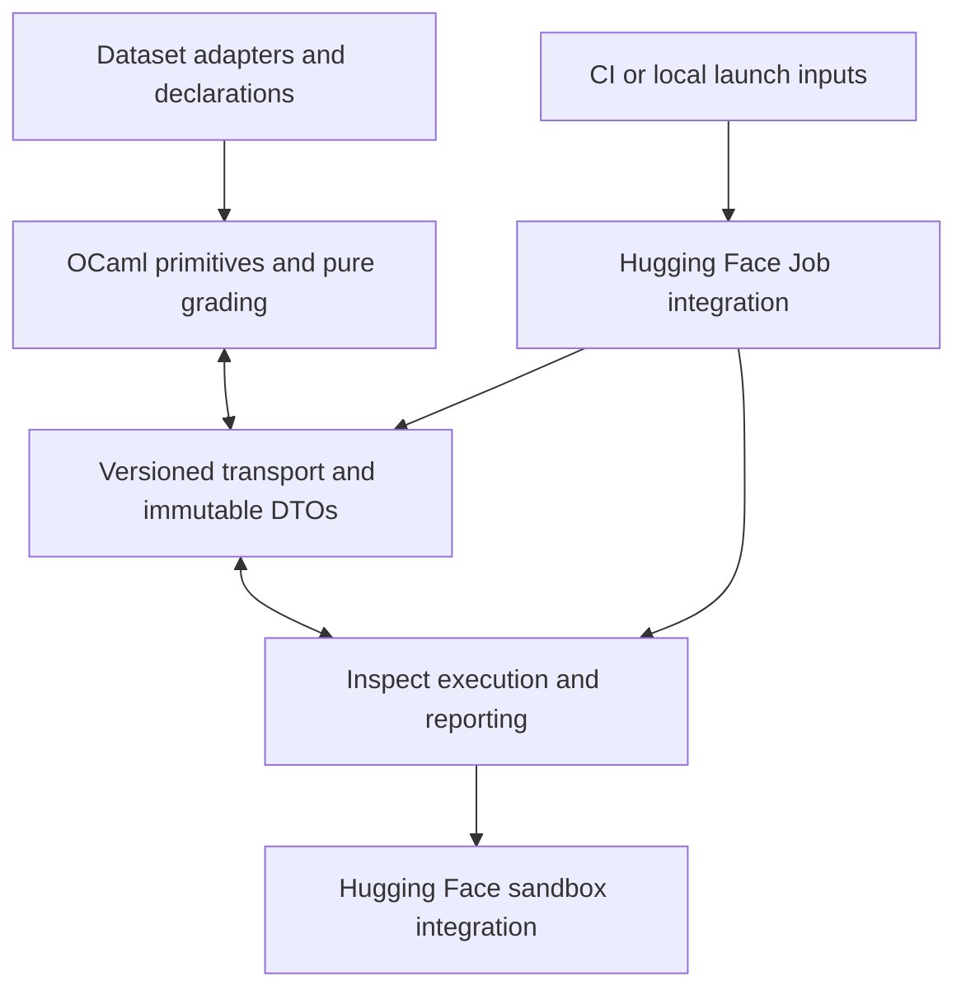

# Genius evals

[Inspect AI](https://inspect.aisi.org.uk/) runs repeated baseline/Genius comparisons and reports normalized results.
[Inspect SWE](https://meridianlabs-ai.github.io/inspect_swe/) supplies Claude Code and Codex integrations.
Hugging Face provides hosted Jobs, model access, and per-sample sandboxes; CI can launch the hosted path on manual dispatch.
Model calls and hosted compute can cost money. The test suite uses local sandboxes and mock models.

OCaml defines and validates evaluations, resolves run settings, and grades observations.
Python integrations execute its immutable projections through one transport boundary.
The kernel is a compiler and pure grader; Inspect retains execution and reporting.



| Boundary | Owns |
| --- | --- |
| `ocaml/ast.ml` | Shared immutable domain type definitions; compiles without domain-module dependencies |
| Primitive `.mli` / `.ml` files | Public operation signatures / executable constructors, validation and pure grading |
| `ocaml/projection.mli` | Separate public case, trusted verifier, and offline reference projections |
| `ocaml/experiment.mli` | Immutable defaults and validated launch overrides |
| `ocaml/dataset.mli`, `ocaml/datasets/` | Common adapter interface; dataset-specific records and provenance |
| `ocaml/codec.ml`, `ocaml/transport.ml` | JSON syntax and generic protocol operations |
| `python/contracts.py` | Frozen, deeply immutable wire projections; no SDK objects or grading rules |
| `python/transport.py` | Trusted source compilation, content-keyed executable caches, protocol encoding/decoding |
| `python/integrations/datasets/` | Adapter discovery, pinned downloads, immutable catalogs and trusted record retention |
| `python/integrations/inspect/` | Tasks, profiles, agents, workspace observations, verification lifecycle and score reporting |
| `python/integrations/hugging_face/` | Job entry point, model adaptation and Sandbox provider |
| `python/integrations/evalplus/` | Benchmark reference-validation CLI and EvalPlus manifest adaptation |
| `python/integrations/verifiers/` | Trusted standalone OCaml/EvalPlus execution driver |

Public `Case` values contain only ID, skill, prompt, and public files, including visible helper tools.
Reference solutions, expected answers, private verifier programs and private inputs use separate projections.
Only the trusted host or fresh grading sandbox receives those projections; agent samples and metadata receive public inputs and identifiers.
Python does not mirror answer expectations, text rules, or criterion variants.

Protocol version 3 exposes generic describe, cases, verifier, reference, experiment, and grade operations.
Every response is versioned. A grading request carries the case ID, raw response text, changed paths, and trusted execution evidence.
It returns named boolean scores. Dataset-specific CLI operations and branches are absent from both transports.
The old combined case manifest is intentionally unsupported; native historical Inspect logs are unchanged.

Dataset selection is an adapter name or, for local library use, a trusted suite path.
An adapter under `ocaml/datasets/<name>.ml` implements `dataset.mli`, compiles as `Dataset`, and constructs ordinary kernel values.
Its `info` is absent for local declarations or contains a pinned gzip JSONL source plus flat provenance attributes.
Its `import` function maps a raw record to a validated case; raw private benchmark JSON is retained byte-for-byte.
Adding a dataset using existing semantics requires only an adapter and declarations, without editing the kernel, transport, or a Python dataset enum.
A genuinely new evaluation capability may require a new primitive.

CI and local launchers supply overrides; OCaml resolves them into one immutable experiment specification before execution.
The HF launcher deliberately requests one epoch by default for its smoke run; direct job invocation uses the kernel default when no override is supplied.
The generic Inspect task builder accepts a sandbox selection and defaults to local execution; only the HF integration registers and selects the HF provider.
SDK clients, credentials and operational state stay in integrations.

Shared domain types are defined once in `ast.ml`; public `.mli` files declare functions using those types, and `.ml` files implement them.
Dataset-record and codec helper types remain private to their implementations.
Raw Ast records are validated at case projection and grading boundaries, including nested criteria, verifier contracts and reference fields.

Catalog lookup is explicit: `catalog.case(case_id, selection=dataset)` and `catalog.reference(case_id, selection=dataset)` return immutable `Case` and `Reference` values.
Dataset selection stays out of the grading observation DTO; scoring uses the case ID it already has.

Primitive modules have no codec or SDK dependencies. Only transport compiles/invokes the kernel; the standalone verifier compiles candidate OCaml in its isolated grading workspace.
Domain DTOs are nonrecursive, while recursive JSON trees are confined to the codec implementation.
Boundary tests enforce these imports and the absence of dataset/provider knowledge in the transport.
Source contents, adapter declarations, private records and verifier resources participate in provenance or cache keys.
Invalid candidate submissions produce unsuccessful outcomes; provisioning, transfer, driver and protocol failures remain harness errors.

## Check the harness offline

Install OCaml 4.13+ (`ocamlc`), ocamlfind, Jsonm, Python 3.12+, [uv](https://docs.astral.sh/uv/getting-started/installation/), Git, and Make.
Install [ocamlformat](https://github.com/ocaml-ppx/ocamlformat) 0.29.0 through opam; Homebrew does not package it.
A separate opam switch can reuse the system compiler:

```sh
brew install opam
opam init --bare --no-setup
opam switch create evals-fmt ocaml-system
opam install --switch evals-fmt ocamlformat.0.29.0 ocamlfind jsonm
export PATH="$(opam var --switch evals-fmt bin):$PATH"
```

From the repository root:

```sh
make -C evals check
```

This installs locked dependencies, checks strict typing, runs tests, and enforces CRAP ≤5.
`check` runs five parts that also run alone: `check-scaffolding`, `check-ocaml-format`
(ocamlformat style), `lint-ocaml` (compilation with every warning as an error),
`test-ocaml` (kernel tests in `ocaml/tests/`), and `check-python` (Ruff format and lint,
strict mypy, tests, coverage, Xenon).
`make -C evals format` applies both styles: ocamlformat from `ocaml/.ocamlformat`
and Ruff from `pyproject.toml`.

Functions take at most one positional argument, usually an ID or the value they
act on. Callers name every other argument. Ruff enforces this for Python
(`PLR0917` with `max-positional-args = 1`), including tests, because pytest
passes fixtures by name. Inspect calls solvers, scorers, and mock-model callbacks
positionally, so those carry a `noqa` with the reason; methods marked
`@override` keep their base signatures. OCaml follows the same rule with labeled
arguments, by review.
Tests exercise Inspect's real engine with its mock model and scripted test agents.
They use temporary local sandboxes and need no API keys.
Scripted passes verify the harness; they do not measure Genius performance.

Reports and native offline logs are saved under `evals/results/`.

## Continuous integration

GitHub Actions minutes are free for this public repository.

- `.github/workflows/evals.yml` runs on pushes and pull requests that touch
  `evals/`, `docs/`, or `skills/`. Its `check` job runs `check-scaffolding`,
  `lint-ocaml`, `test-ocaml`, and `check-python` in the Hugging Face Job image
  (`ghcr.io/astral-sh/uv:python3.12-bookworm` with Debian's OCaml 4.13, ocamlfind and Jsonm). Its
  `format` job runs `check-ocaml-format` with ocamlformat 0.29.0.
- `.github/workflows/hf-evals.yml` launches a paid hosted run on manual dispatch
  (Actions → HF evals → Run workflow). It runs the `evals.yml` checks first, then
  `hf_host.sh`, streams the Job logs, and fails if the Job fails. Add an `HF_TOKEN`
  repository secret with write access. HF Inference Providers models use this same
  token, with inference permission; no separate provider key is required. Add
  `OPENAI_API_KEY` or `ANTHROPIC_API_KEY` only for direct calls to those providers.
  The `HF_NAMESPACE` repository variable defaults to the repository owner.

GitHub dispatches only workflows that exist on the default branch. Before this
workflow reaches `main`, launch from a local checkout with `sh evals/hf_host.sh`;
it needs only uv, Git, and a Hugging Face login.

## Run live comparisons on Hugging Face

Create a [Hugging Face account](https://huggingface.co/join) with a positive Jobs
credit balance. Authenticate from the shared workspace with
`uvx --from huggingface_hub==2.2.0 hf auth login`; the browser login keeps the
token out of chat. A Hugging Face Inference Providers model needs only that
Hugging Face token. OpenAI and Anthropic models need their own provider API keys;
a ChatGPT or Claude subscription does not supply an API key for Inspect.

HF Job logs name the provider `genius-hf`: this adapter uses Inspect's HF provider
and removes Codex's `prompt_cache_key`, which HF's chat endpoint rejects. It uses
non-strict tool schemas so Codex's optional arguments remain valid. It keeps the
requested model ID and HF authentication.

Run from a checkout of the completed eval stack, or `main` after both PRs
merge. The private source repository and results bucket already exist for
`shaquan1228`; the launch script safely reuses them. From the repository root:

```sh
uvx --from huggingface_hub==2.2.0 hf auth whoami
export HF_NAMESPACE='shaquan1228'
export EVAL_MODEL='hf-inference-providers/openai/gpt-oss-20b:nscale'
sh evals/hf_host.sh
```

That first example runs the Codex harness against a Hugging Face hosted model.
The `:nscale` suffix pins its inference provider. The automatic Groq route
returned malformed tool names during smoke testing; use an explicit provider
when comparing runs.
To evaluate the target Codex or Claude models, use `openai/<pinned-model-id>`
with `OPENAI_API_KEY` or `anthropic/<pinned-model-id>` with `ANTHROPIC_API_KEY`.
Set the matching key in your shell or secret manager before launching the Job.
The script selects Codex for Hugging Face and OpenAI models, and Claude Code for
Anthropic models. Set `EVAL_AGENT` and `EVAL_VERSION` to override the agent or
its pinned version.
The first run defaults to one epoch (eight agent sessions) to test the hosted
path. After checking its results, run `EVAL_EPOCHS=5 sh evals/hf_host.sh` for
the full 40-session comparison.

`hf_host.sh` uploads only tracked files from the current Git commit, so commit
changes before running it. It creates a private dataset repository containing
the evaluation source, a private results bucket, and a Hugging Face Job. The
launcher streams logs and waits for the final Job status; it exits nonzero if the
Job fails. The Job runs Inspect and launches a dedicated Hugging Face Sandbox VM
for each sample.
Only task files and the selected skill enter that VM; held-out checks stay in
the Job and run against the VM after the agent finishes. The script prints the
Job ID. Watch it at `https://huggingface.co/jobs/shaquan1228/<job-id>` or with:

```sh
uvx --from huggingface_hub==2.2.0 hf jobs logs -f <job-id>
uvx --from huggingface_hub==2.2.0 hf jobs inspect <job-id>
```

The logs command streams output; use `jobs inspect` to confirm the final status.
Native Inspect logs are saved to the private
[`genius-eval-results` bucket](https://huggingface.co/buckets/shaquan1228/genius-eval-results)
under `live/`.

Both profiles share the selected model, agent version, effort, tools, and limits.
Every sample and epoch starts with fresh task files and a fresh agent session.
Codex configuration and session state live under `/root/genius-codex`, outside
the measured repository, so harness bookkeeping does not count as agent edits.
Codex refuses to install its `apply_patch` helper when its home is under `/tmp`.
Login shells are disabled so shell startup files do not discard the helper's `PATH` entry.
The agent's `attempts=1` prevents retries after a failed submission within one
session; epochs provide independent attempts for estimating pass rates.
Agent retries and model-response caching are disabled. Provider transport retries retain Inspect defaults.
Each session allows 40 messages, 50,000 tokens, and 300 seconds.
Task metadata records agent versions and hashes of instructions, fixtures, and the manifest.
Inspect logs record model usage, sample events, answers, errors, and scores.

Compare each task across profiles; require both correctness and scope to pass.
Inspect reports each score separately. Scores are not inferred from agent claims.

A crash of the agent process does not stop the task.
The scorer grades the files that the agent left in the workspace.
An unchanged workspace fails its checks.
The score records the crash message in its `agent_failure` metadata and its explanation.
The task then continues with the next sample.
The Job log shows the number of crashed samples for each task.
Sandbox and verifier failures still stop the task.

## Author cases

A suite declares the parts of a case explicitly:

```ocaml
let cases =
  [
    Case.make
      ~id:"quantity"
      ~fixture:(Fixtures.Receipt.fixture ~bug:Ignore_quantity)
      ~instruction:Scenarios.Receipt.fix_total
      ~criterion:
        Scenarios.Receipt.(
          totals
            [
              expect ~items:[ item ~price:3.0 ~quantity:4 ] ~total:12.0;
              expect ~items:[ item ~price:3.0 ~quantity:0 ] ~total:0.0;
            ])
      ~allowed_files:[ "receipt.ml" ]
      ~reference:Scenarios.Receipt.reference;
  ]
```

The fixture does not choose the prompt, expectations, reference answer, or edit
scope. Scope is declared independently of reference edits. A suite may reuse a
fixture with different tasks or checks. `Fixture.of_files` rejects duplicate
paths; `Fixture.overlay base ~overrides` explicitly replaces matching paths and
leaves both inputs unchanged. `Case.make` rejects checks that read files missing
from the fixture and reference edits outside `allowed_files`; the error names the
case and the files.

Use helpers inside a suite to describe larger parameter sets:

```ocaml
let timeout_case i =
  let requested = 30 + i in
  Case.make
    ~id:(Printf.sprintf "timeout-%d" i)
    ~fixture:(Fixtures.Preflight.fixture ~timeout:15)
    ~instruction:(Scenarios.Preflight.change_timeout ~initial:15 ~requested)
    ~criterion:(Scenarios.Preflight.defaults ~timeout:requested)
    ~allowed_files:[ "config.ml"; "client.ml" ]
    ~reference:(Scenarios.Preflight.reference ~timeout:requested)

let cases = List.init 200 timeout_case
```

A new starting project belongs in `ocaml/fixtures.ml`. Scenario instructions, assertions,
and reference outputs belong in `scenarios.ml`. Add a reusable success condition to
`ast.ml`, its validating constructor to `criterion.ml`, and its pure evaluation to
`grader.ml`. Case IDs have no matching directory
or Python registry entry.

For a new structured answer, use `Response.of_fields` to declare string/boolean values
and `Criterion.answer` for its expectation. An optional `Ast.text_rule` record declares
a named string field and inclusive word bounds; `Criterion.answer` validates it. A field
named `reason` has no special meaning unless the criterion declares it. Reference replies
use `Ast.Structured`.
Adding answer fields does not require Python or transport changes.

## Execution boundary

The host compiles the fixed OCaml module set in a temporary directory.
`ocaml/transport.ml` consumes the selected `Dataset` adapter and emits versioned JSON projections; `python/transport.py`
decodes those projections into frozen values. Importing `Suite` itself has no output or
execution side effects. Compilation and validated case indexes are cached
by source contents; changing any module, interface, or the runner invalidates
the cache.
No generated files are written into this checkout. Both local checks and the
hosted Job need OCaml 4.13+; the hosted bootstrap installs Debian's `ocaml-nox`, `ocaml-findlib`, and `libjsonm-ocaml-dev`.

Inspect receives only public project files, selected skill instructions, and a
case ID. Private checks and reference edits stay in the host's case index; they
are not copied into sample metadata or the agent workspace. Only the offline
scripted test agent applies the reference edits.

`bin/enforce` is the shared compiler runner. It compiles temporary copies and cleans
up after success or failure, leaving no compiler artifacts in the measured
worktree. Evaluation tasks receive it as `check.sh`, so a generated workspace can
run its visible checks with, for example:

```sh
sh check.sh receipt.ml test_receipt.ml
```

After the agent finishes, the harness creates a fresh grading sandbox using the
same provider. It copies only the declared submission inputs and trusted verifier
artifacts, then streams private input to the declared command. The driver returns
a structured outcome with a fresh completion marker. Provisioning and transfer
timeouts are harness errors; the verifier command's deadline is a distinct timeout
outcome. The grading sandbox is cleaned up after success, failure, or cancellation.

The OCaml verifier is one instance of this contract. It uses a separate inner
completion marker after all private assertions, so an early successful exit fails
correctness. Agent edits to public helper scripts do not alter the trusted grader
copies. Completion markers do not isolate hostile code sharing the grader process.

Scope checks compare the final worktree against its original commit.
They detect agent commits, untracked files, ignored files, and changed instructions.

The four cases cover clear-task completion, known preflight fields, numeric choice, and hindsight after one loss.
The suite composes sources, prompts, and assertions from their respective modules.
Reply checks compare each expected field with its exact JSON type and bound the reason;
they do not judge explanation quality.
Question usefulness and reasoning quality require human review of saved traces.
These small regression tasks do not establish that Genius improves performance overall.

## Enforce CRAP ≤5

The standard [CRAP formula](https://pypi.org/project/pytest-crap/) is:

```text
CRAP = complexity² × (1 − coverage)³ + complexity
```

`make check` requires 100% statement and branch coverage using coverage.py.
Xenon's rank-A gate requires every function's cyclomatic complexity to be at most five.
At full coverage, CRAP equals complexity, so those gates enforce CRAP ≤5.
Radon exports measured complexity to `results/complexity.json`.

Python coverage and complexity include all adapter runtime code, harness tests,
and scripted helpers. OCaml checks are verified by compiling and executing the
seeds, solved fixtures, partial fixes, malformed code, and visible test commands.
`make test-ocaml` checks module boundaries, case relationships, and grading policy.
Neither is included in Python coverage or the Python CRAP calculation.
Strict mypy checks the Python modules without type-ignore exceptions; `ocamlc`
type-checks fixture modules and assertions on every execution.


## HumanEval+ coding benchmark

`humanevalplus` imports all 164 HumanEval+ v0.1.10 problems into typed OCaml
`Case` values. The upstream release is public and requires no API key. The free commands below show the pinned provenance, then download and
checksum-verify the dataset into the user cache and validate three references:

```sh
uv run --project evals python -m evals.python.integrations.evalplus.benchmarks info
uv run --project evals python -m evals.python.integrations.evalplus.benchmarks validate --limit 3
```

On macOS, trusted reference validation can explicitly work around EvalPlus's
incompatible memory guard with `--trusted-macos-memory-workaround`. This flag is
only for the bundled upstream reference code. Live candidate evaluation keeps
EvalPlus's default memory guard in the Linux grading sandbox.

Each agent sees only `solution.py`, containing the original prompt and function
signature. Baseline and Genius receive the same public problem. Canonical
solutions and base/plus inputs stay in the private host index and fresh grading
environment. The original JSON record crosses the kernel as an opaque string,
preserving integers larger than floating-point precision. Grading runs the
pinned official EvalPlus checker, separately for base and plus inputs; correctness
requires both groups to pass. Metadata records both upstream statuses, test
counts, dataset digest, evaluator commit, and runtime versions. A timeout remains
an upstream timeout result; infrastructure errors fail the sample.

`evals/ocaml/datasets/humanevalplus.ml` owns dataset provenance and constructs the cases.
`ExecutableChecks` runs them through the same generic verifier as other coding
cases. No dataset-specific scorer or Python-to-OCaml transpilation of benchmark
programs is required. The evaluator is pinned to commit
`6eb1e199c2e370518e7bf3e8eee6322c2b23c89c`; its minimal evaluation dependencies
are pinned in the project lockfile. Fresh sandbox graders install those exact
packages into a temporary private directory when unavailable.

Canonical solutions are validation candidates, not scoring authority. The
unmodified v0.1.10 reference for `HumanEval/32` fails the official expanded tests
with this evaluator due to a numerical issue. Its failure is retained and
reported; the adapter does not weaken or rewrite the benchmark. Reference
validation exits nonzero when any case fails or encounters an infrastructure
error.

For a model run, select `humanevalplus` in the manual HF workflow and optionally
set `limit` for a small probe. The equivalent local launcher settings are
`EVAL_DATASET=humanevalplus EVAL_LIMIT=3`; omitting `EVAL_LIMIT` runs all 164
problems per profile and epoch. `EVAL_JOB_TIMEOUT` defaults to `4h` and can be
explicitly increased for larger runs. No model calls or paid Jobs are made by the
`benchmarks` CLI. Inspect logs include the dataset selection, pinned provenance,
case hash, and each sample's verifier evidence.
